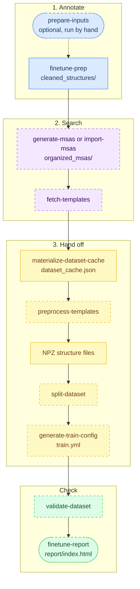

# How the pipeline works

The pipeline turns a directory of mmCIF files into everything OpenFold3 needs to train. Each structure gets one self-contained annotated CIF, and the rest is built from those.

## The three steps

`finetune-pipeline` runs these commands from top to bottom. Dashed boxes are stages that are optional or that a flag can skip.

| Stage | Runs when |
|---|---|
| `prepare-inputs` | You run it by hand, before the pipeline |
| `import-msas` | `--msa-sources` is given |
| `generate-msas` | `--organized-msa-dir` is given, without `--msa-sources` |
| `fetch-templates`, `preprocess-templates` | `generate-msas` ran, and `--no-templates` is not given |
| `split-dataset` | `--split-csv` is given |
| `generate-train-config` | There is an MSA folder: one from step 2, or an `<output-dir>/organized_msas` left by an earlier run |
| `validate-dataset` | `--skip-validation` is not given |
| `finetune-report` | `--skip-report` is not given |

Every other stage always runs.

| Step | Commands | Output |
|---|---|---|
| **1. Annotate** | `prepare-inputs` (optional), `finetune-prep` | Cleaned CIFs with OpenFold3 metadata, and reference molecules |
| **2. Search** | `import-msas` or `generate-msas`, then `fetch-templates` | MSAs and template structures |
| **3. Hand off** | `materialize-dataset-cache`, `preprocess-templates`, NPZ structure files, `split-dataset`, `generate-train-config` | The dataset cache, NPZ files and `train.yml` |
| **Check** | `validate-dataset`, `finetune-report` | `validation.json` and `report/index.html` |

`finetune-pipeline` runs all three, then validates the dataset and writes the report. `prepare-inputs` is never part of it: run it by hand first if your inputs need it.

Keep the outputs of steps 1 and 2. Step 3 is only what OpenFold3's trainer needs, and you can rebuild it at any time.

## Cleaning

The pipeline cleans structures the way OpenFold3 cleans its own training data. Waters, crystallization aids and clashing chains go, for example, and every step is logged per structure.

A structure that cleanup empties, or that cannot be prepared, is left out and the run carries on. The report lists it with the reason.

## Interfaces

The pipeline records which chains touch each other. Training uses these interfaces to choose crops, and validation scores them.

## MSAs

Each unique protein sequence gets one MSA from the ColabFold server, keyed by a hash of the sequence. Identical chains share it, so 925 structures with 8 sequences need only 8 searches.

MSAs live in two layouts. `unpaired/` and `paired/` hold what ColabFold returned, and `of3_alignments/` is the layout OpenFold3 reads. `of3_alignments/` is what `train.yml` points to.

You can bring your own MSAs instead with `import-msas` (see [Use your own MSAs](../how-to/user-msas.md)). They are stored per source under `msa_sources/`, in the same hashed layout as ColabFold's `unpaired/`. Either way, `msa_index.yml` lists the sources in the folder, and every later step reads that list rather than asking which tool made the MSAs.

## Templates

Each sequence's ColabFold hits go through these steps, in order:

1. **`--max-hits`** (50): download the first 50 unique PDB entries. Later hits are dropped here.
2. **Sequence filters:** drop hits that are near-exact copies of the query, under 10 residues, or cover at most 10% of the query.
3. **Release date:** a template must be 60 days older than the structure.
4. **`--max-templates`** (20): keep the 20 best per chain.

Step 1 comes first, so if most top hits are copies of the query, few templates survive. With a [fixed cutoff](../how-to/template-cutoff.md), step 3 uses one date for every structure.

## Further reading

- [Why these design decisions](design-decisions.md)
- [What validate does](validate.md)
