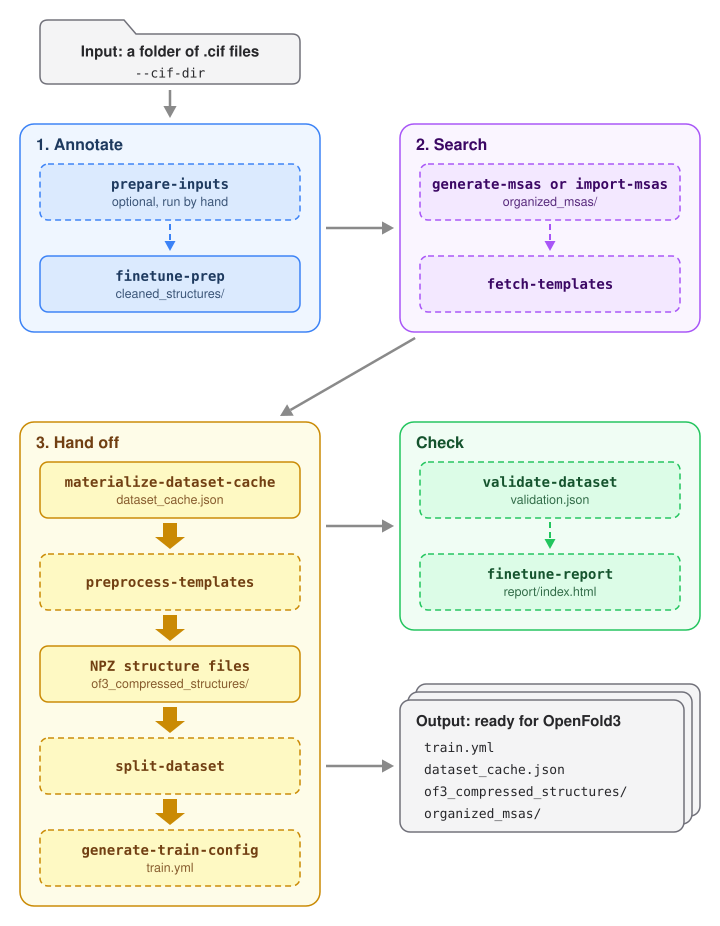

# How the pipeline works

The pipeline turns a directory of mmCIF files into everything OpenFold3 needs for training. Each structure is first written as a single self-contained, annotated CIF, and all later outputs are built from these files.

## The three steps

`finetune-pipeline` runs these commands in the order shown by the arrows. Dashed boxes are stages that are optional, or that an option can skip.

| Stage | Runs when |
|---|---|
| `prepare-inputs` | Run separately, before the pipeline |
| `import-msas` | `--msa-sources` is given |
| `generate-msas` | Neither `--no-msa-search` nor `--msa-sources` is given |
| `fetch-templates`, `preprocess-templates` | `generate-msas` ran, and `--no-templates` is not given |
| `split-dataset` | `--split-csv` is given |
| `generate-train-config` | There is an MSA folder: one from step 2, or, with `--no-msa-search`, an existing `--organized-msa-dir` (by default `<output-dir>/organized_msas`) |
| `validate-dataset` | `--skip-validation` is not given |
| `finetune-report` | `--skip-report` is not given |

Every other stage always runs.

| Step | Commands | Output |
|---|---|---|
| **1. Annotate** | `prepare-inputs` (optional), `finetune-prep` | Cleaned CIFs with OpenFold3 metadata, and reference molecules |
| **2. Search** | `import-msas` or `generate-msas`, then `fetch-templates` | MSAs and template structures |
| **3. Hand off** | `materialize-dataset-cache`, `preprocess-templates`, NPZ structure files, `split-dataset`, `generate-train-config` | The dataset cache, NPZ files and `train.yml` |
| **Check** | `validate-dataset`, `finetune-report` | `validation.json` and `report/index.html` |

`finetune-pipeline` runs all three steps, then validates the dataset and writes the report. `prepare-inputs` is not part of the pipeline; if your inputs need it, it is run separately beforehand.

The outputs of steps 1 and 2 should be kept. Step 3 produces only what OpenFold3's trainer needs, and can be rebuilt at any time.

## Cleaning

The pipeline cleans structures in the same way that OpenFold3 cleans its own training data. For example, waters, crystallization aids and clashing chains are removed, and every step is logged for each structure.

A structure that cleanup leaves empty, or that cannot be prepared, is left out, and the run continues. The report lists it with the reason.

## Interfaces

The pipeline records which chains are in contact with each other. Training uses these interfaces to choose crops, and validation scores them.

## MSAs

Each unique protein sequence receives one MSA from the ColabFold server, stored under a hash of the sequence. Identical chains share the same MSA, so 925 structures with 8 distinct sequences require only 8 searches.

MSAs are stored in two layouts. `unpaired/` and `paired/` hold the results returned by ColabFold, and `of3_alignments/` is the layout that OpenFold3 reads and that `train.yml` points to.

You can provide your own MSAs instead, with `import-msas` (see [Use your own MSAs](../how-to/user-msas.md)). They are stored per source under `msa_sources/`, in the same hashed layout as ColabFold's `unpaired/`. In both cases, `msa_index.yml` lists the sources in the folder, and every later step reads that list rather than depending on which tool produced the MSAs.

## Templates

The ColabFold template hits for each sequence are filtered in the following order:

1. **`--max-hits`** (50): the first 50 unique PDB entries are downloaded, and later hits are dropped.
2. **Sequence filters:** hits are dropped if they are near-exact copies of the query, shorter than 10 residues, or cover at most 10% of the query.
3. **Release date:** a template must have been released at least 60 days before the structure.
4. **`--max-templates`** (20): the 20 best templates are kept for each chain.

Because step 1 comes first, few templates remain if most of the top hits are copies of the query. With a [fixed cutoff](../how-to/template-cutoff.md), step 3 uses the same date for every structure.

## Further reading

- [Why these design decisions](design-decisions.md)
- [What validate does](validate.md)
